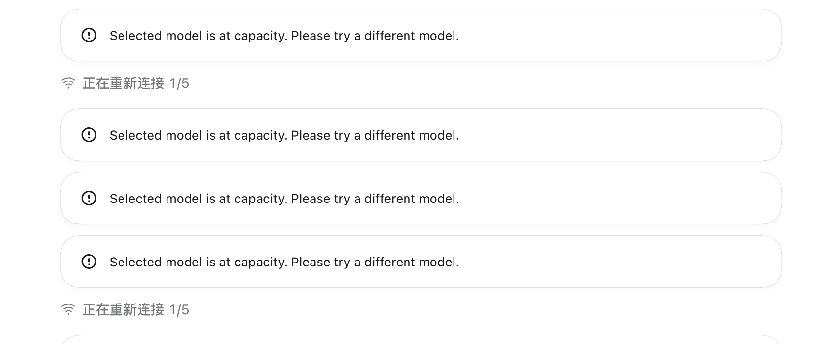
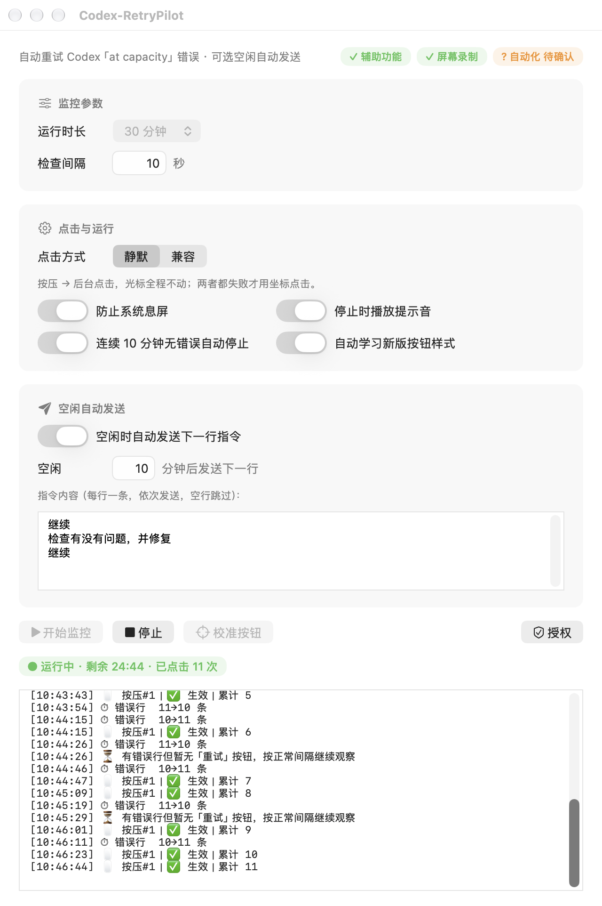

<div align="center">

# Codex-RetryPilot

> **无用到有用，只差每天一点。**

### Codex 卡住了？让 RetryPilot 替你点「重试」。

让 Codex 自动应对模型繁忙，告别反复手动重试。  
**任务继续跑，你该干什么就干什么。**

**自动重试 · 后台静默 · 无人值守 · 完全开源**

[中文介绍](#中文) · [English](#english) · [下载最新版本](https://github.com/yuxi1989/Codex-RetryPilot/releases) · [MIT License](LICENSE)

</div>

---

<a id="中文"></a>

## 中文

### 你负责创造，它负责重试

给 Codex 安排了一个长任务，转头去喝杯咖啡，回来却发现它早就停在了：

> `Selected model is at capacity. Please try a different model.`



更糟的是，半夜任务跑到一半卡住，第二天才发现几个小时白白浪费了。

**Codex-RetryPilot 就是为了解决这个小麻烦而生。** 它会自动检测 Codex 的模型容量限制错误，找到「重试」按钮并替你点击。无需守着屏幕，也不用反复手动操作。

### 一个小工具，解决一个烦人的问题



- **自动重试**：检测到模型容量限制错误，自动寻找并点击「重试」。
- **静默后台**：优先使用不移动鼠标、不抢占焦点的方式操作。
- **无人值守**：自定义检测间隔、运行时长，让长任务持续等待恢复。
- **智能验证**：点击后检查按钮状态，减少误判和无效操作。
- **指令接力**：Codex 持续空闲达到指定时间后，自动发送指令队列中的下一条。
- **安全可控**：提供运行日志、自动停止、提示音及配置导入导出。

### 下载与安装

**无需自行编译，直接下载已发布的安装包。**

**[下载最新版本 → GitHub Releases](https://github.com/yuxi1989/Codex-RetryPilot/releases)**

1. 打开 Releases 页面，下载适用于 macOS 的 `.dmg` 或 `.zip` 安装包。
2. `.dmg` 直接打开后把应用拖进「应用程序」；`.zip` 解压后把 `.app` 拖进「应用程序」。
3. 首次启动应用，按提示完成授权。
4. 打开 Codex 桌面客户端。
5. 在 RetryPilot 里设置检测间隔、运行时长，点开始运行。

首次使用需要以下权限：

| 系统权限 | 用途 |
|---|---|
| 辅助功能（必需） | 识别并点击 Codex 的重试按钮 |
| 屏幕录制（必需） | 截图并识别目标界面 |
| 自动化（可选） | 兼容模式下恢复原应用焦点 |

> **应用签名与公证：** 发布版本已通过 Apple 公证（Notarized Developer ID）并装订票据，下载后双击即可打开，无需右键或 `xattr` 处理。

### 安静工作，不打扰你

RetryPilot 提供两种重试模式。

**静默模式（默认）**：优先通过辅助功能和原生后台点击触发重试，不主动移动鼠标或切换焦点。适合日常使用。

**兼容模式**：增加坐标点击兜底。只有确认当前界面存在目标「重试」按钮时才允许点击，并尝试恢复原来的应用焦点。

无论哪种模式，都不会绕过 Codex 的模型容量限制。工具负责自动尝试恢复，实际能否继续执行仍取决于 Codex 服务状态。

### 纯本地运行，简单透明

**不联网、不注册、不上传数据。**

- 无远程服务依赖
- 无遥测统计和自动更新检查
- 无需 API Key
- 不上传 Codex 会话、截图或日志
- 本地保存配置，支持 JSON 导入导出
- Swift 原生实现，无第三方依赖

程序需要使用 macOS 的辅助功能和屏幕录制权限，请根据实际需求授权。

### 系统要求

- macOS 13 Ventura 或更高版本（推荐 macOS 14 Sonoma 及以上）
- Universal 二进制，Apple Silicon 与 Intel Mac 均可
- Codex 桌面客户端

### 从源码构建

项目核心代码为单个 `main.swift`，无需第三方依赖。需要安装 Xcode Command Line Tools。

```bash
cd /path/to/Codex-RetryPilot
export SDKROOT=$(xcrun --show-sdk-path)
xcrun swiftc -O main.swift -o CodexRetry
```

如需生成可分发的 `.app` 或 `.dmg`，还需要完成应用打包和代码签名。

### 为什么做这个工具？

因为 Codex 很能干，但偶尔也会罢工。一个简单的模型繁忙提示，不应该让几个小时的任务停在那里等人处理。

于是有了 RetryPilot。它不是什么复杂的软件，只是替你做一件重复又烦人的事：**当 Codex 卡住时，帮你再试一次。**

整个项目由 WorkBuddy 辅助开发，没有手写过一行代码。

**无用到有用，只差每天一点。**

### 开源协议

本项目采用 **[MIT License](LICENSE)** 开源。

欢迎自由使用、修改和分发，也欢迎提交 Issue 和 Pull Request。

**项目仓库：** [yuxi1989/Codex-RetryPilot](https://github.com/yuxi1989/Codex-RetryPilot)

---

<a id="english"></a>

## English

> **From useless to useful — just a little every day.**

**Codex stuck? Let RetryPilot hit Retry for you.**

Stop babysitting Codex when models are at capacity. Let your tasks keep moving while you focus on something else.

**Auto Retry · Silent Background · Unattended · Open Source**

### You create, it retries

You start a long-running Codex task, grab a coffee, and return to find:

> `Selected model is at capacity. Please try a different model.`


Codex-RetryPilot detects this error, finds the Retry button, and automatically attempts to resume your session. No constant checking. No repetitive clicking.

### One small tool. One annoying problem solved.


- **Auto Retry** — Detect model capacity errors and automatically trigger Retry.
- **Silent Background** — Prioritize interactions that do not move your cursor or steal focus.
- **Unattended Operation** — Configure monitoring intervals and run duration.
- **Retry Verification** — Check button state after each attempt.
- **Command Queue** — Automatically send the next instruction after a configurable idle period.
- **Simple Controls** — Logs, idle auto-stop, sound notifications, and JSON configuration import/export.

### Download & Install

[Download from GitHub Releases](https://github.com/yuxi1989/Codex-RetryPilot/releases)

1. Download the macOS `.dmg` or `.zip` release asset.
2. Drag the app into your Applications folder.
3. Launch the app and grant the required macOS permissions.
4. Open the Codex desktop client.
5. Configure RetryPilot and start monitoring.

Required permissions: Accessibility and Screen Recording. Automation is optional. Release builds are notarized by Apple (Notarized Developer ID) with the ticket stapled — double-click to open, no right-click or `xattr` workaround needed.

### Two retry modes

**Silent (default)** — triggers Retry through accessibility and native background clicks, without moving your cursor or stealing focus.

**Compatible** — adds a coordinate-click fallback. It only fires when the target Retry button is confirmed on screen, and then restores focus to your previous app.

Neither mode bypasses Codex model capacity limits. The app retries automatically; whether your task resumes still depends on Codex service availability.

### Privacy First

**No network, no account, no data collection.**

- Fully local operation
- No telemetry or automatic update checks
- No accounts or API keys
- No uploaded conversation data, screenshots, or logs
- Local configuration storage with JSON import/export
- Native Swift implementation with no third-party dependencies

### Requirements

macOS 13 Ventura or later (14 Sonoma+ recommended), universal binary for Apple Silicon and Intel Macs, and the Codex desktop client.

### Build from Source

Install Xcode Command Line Tools, then run:

```bash
cd /path/to/Codex-RetryPilot
export SDKROOT=$(xcrun --show-sdk-path)
xcrun swiftc -O main.swift -o CodexRetry
```

Application packaging and code signing are additional steps for distribution.

### Why RetryPilot?

Because Codex is capable, but sometimes it stops working. A temporary capacity error should not park hours of work waiting for a human.

So RetryPilot exists. It is not complicated software — it just does one repetitive, annoying thing for you: **when Codex gets stuck, it tries again.**

Built entirely with WorkBuddy, without manually writing a single line of code.

**From useless to useful — just a little every day.**

### License

Released under the **[MIT License](LICENSE)** — free to use, modify, and distribute under its terms.

[GitHub Repository](https://github.com/yuxi1989/Codex-RetryPilot)
